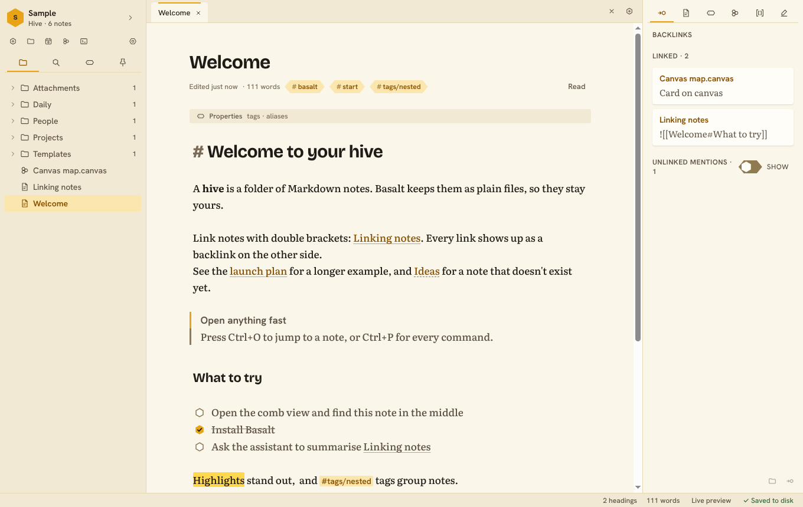

# Basalt

Basalt is a local-first Markdown notes app built so AI can work with your notes too. A **hive** is any folder of Markdown files. Basalt links, searches and maps that folder without locking it in, and any AI model or agent you choose can work in it with you.



| Basalt (dark) | Comb view | Canvas |
|---|---|---|
|  |  |  |

## What's in it

**Writing and linking**
- Live preview editor (syntax shows only around the cursor), source mode and reading view.
- `[[links]]`, `[[Note#Heading]]`, `[[Note#^block]]`, `[[Note|alias]]` and `![[embeds]]` for notes, images, PDFs, audio and video. Autocomplete for notes, headings, blocks and tags.
- Callouts, tasks, `==highlights==`, `%%comments%%`, footnotes, KaTeX math, Mermaid diagrams and highlighted code.
- Backlinks with unlinked mentions you can link in one click. Hover a link to preview the note.
- Renaming or moving a note rewrites every link to it, including links inside canvases.

**Finding and organising**
- Search with operators: `file:`, `path:`, `tag:`, `line:()`, `section:()`, `task-todo:`, `[property:value]`, `[rating:>3]`, `/regex/`, `OR` and `-exclude`.
- **Search by meaning** and **related notes**. These work offline with no setup; for better results, switch them to an embedding model.
- File tree with drag-to-move, tags pane with nested tags, bookmarks, outline, a properties editor, and table views that filter and sort notes by their properties.
- **Comb view**: your link graph laid out on a honeycomb. The local comb puts the open note in the middle with linked notes in rings around it; the global comb clusters the whole hive.
- Canvas boards in the open JSON Canvas format.
- Daily notes, templates, unique notes and file recovery snapshots.
- Tabs and split panes, a command palette and quick switcher, rebindable hotkeys, Comb (light) and Basalt (dark) themes, and CSS snippets.

**Built for AI**
- **Assistant** that answers using your current note, your selection, or relevant notes from across the hive, and links the notes it used. It works with Claude, OpenAI, Gemini, and any OpenAI-compatible endpoint, including **local models** in Ollama or LM Studio. API keys stay in your system keychain.
- **`basalt mcp`**: an MCP server, so Claude Code, Claude Desktop or any other MCP client can search, read, create, append to, set properties on and rename notes. It has no delete tool, and replacing a whole note requires an explicit flag.
- **`basalt` CLI** with `--json` on every command, for scripts and agents.
- **`.basalt/agents.md`**: a short conventions file that tells agents and the assistant how your hive is organised.

Basalt opens an existing folder of Markdown notes as it is. App state lives in `.basalt/` inside the hive; your notes stay plain Markdown. See [format compatibility](docs/research/format-compat.md).

## Getting started

Requires Node 20 or newer.

```bash
npm install
```

```bash
npm run build
```

Run the desktop app in development:

```bash
npm run dev -w @basalt/desktop
```

Package a Linux build (output in `apps/desktop/release/`):

```bash
npm run package -w @basalt/desktop
```

## Connect an agent

Claude Code:

```bash
claude mcp add basalt -- node /path/to/Basalt/packages/cli/dist/basalt.mjs mcp -H /path/to/your/hive
```

From the command line:

```bash
node packages/cli/dist/basalt.mjs -H ~/Notes search 'tag:#project task-todo:'
```

```bash
node packages/cli/dist/basalt.mjs -H ~/Notes query --where '[status:active]' --sort due
```

```bash
ANTHROPIC_API_KEY=… node packages/cli/dist/basalt.mjs -H ~/Notes ask 'What did I decide about the launch?'
```

`ask` uses whichever provider has a key set: `ANTHROPIC_API_KEY` (Claude, default model `claude-opus-5-5`), `OPENAI_API_KEY`, `GEMINI_API_KEY`, `OPENROUTER_API_KEY`, `GROQ_API_KEY`, `MISTRAL_API_KEY`, or `BASALT_OPENAI_COMPAT_URL` for any OpenAI-compatible server. For semantic search with a provider's embedding model, set `BASALT_EMBEDDINGS=<provider id>`.

In the app, **Settings → Agents and CLI** shows these commands already filled in for the hive you have open.

## Repository layout

| Path | What it is |
|---|---|
| `packages/core` | Hive engine: parser, link resolver, rename rewriter, search language, properties, templates, JSON Canvas, comb layout, Markdown renderer |
| `packages/ai` | Model adapters (Claude via the Anthropic SDK; OpenAI, Gemini and OpenAI-compatible via HTTP), embeddings, semantic index, prompt building |
| `packages/cli` | `basalt` CLI and the MCP server |
| `packages/ui` | The Basalt design system for React, with tokens generated from `design-system/project/tokens.json` |
| `apps/desktop` | The Electron app: main process, sandboxed preload and React renderer |
| `design-system/` | The Basalt design system |
| `fixtures/sample-hive` | A sample hive, used by the tests and offered on the start screen |
| `docs/` | Feature inventory, format notes and the security audit |

## Testing

```bash
npm test
```

```bash
npm run typecheck
```

End-to-end, against the real Electron app on a copy of the sample hive. On Linux without a display, wrap it in `xvfb-run -a`.

```bash
npm run test:e2e
```

## Security

The window runs with context isolation, the renderer sandbox and no Node integration. The renderer reaches the main process only through a fixed set of IPC calls, which reject any frame that isn't Basalt's own. File access stays inside the open hive, and the packaged binary disables Electron's Node entry points. See the [REA audit](docs/security/rea-audit.md).

## How Basalt was designed

Basalt was designed from a clean-room inventory of features, built from public, openly licensed specifications and documented behaviour. No proprietary code was decompiled or copied. See [docs/research/feature-inventory.md](docs/research/feature-inventory.md) for what's built now and what comes next: database views, slides, sync, publish, mobile and a plugin API.
