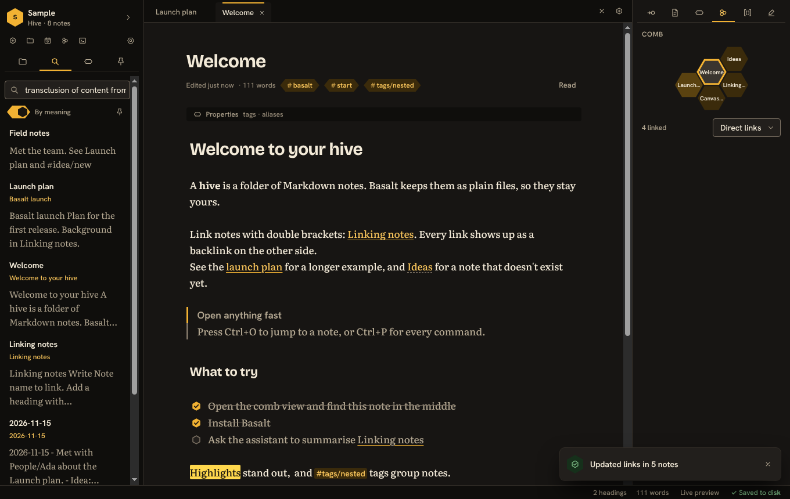
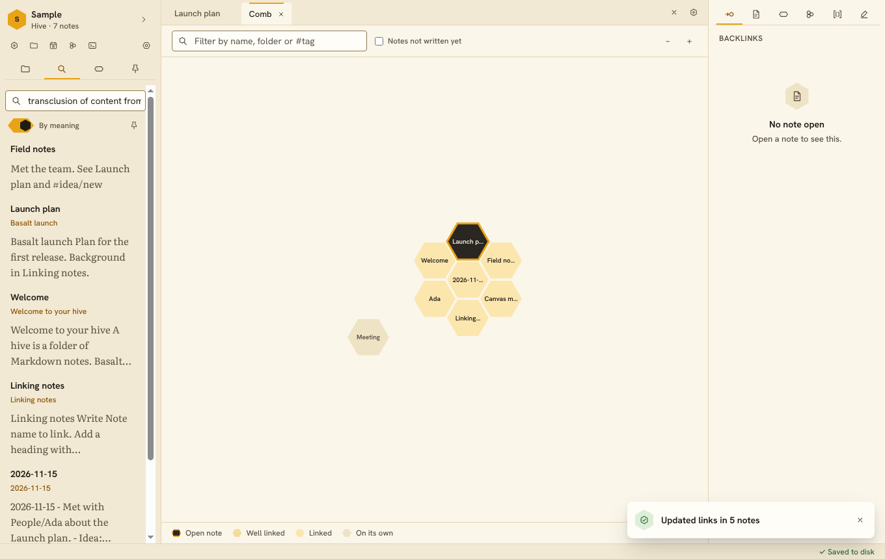
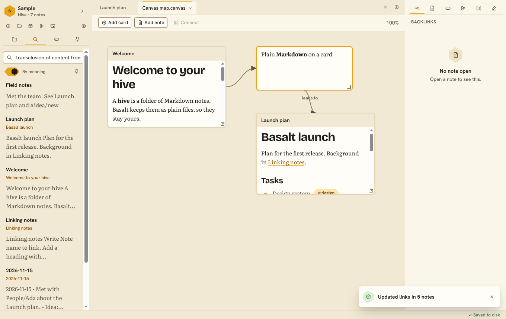

# Basalt

Basalt is a local-first Markdown notes app built so AI can work with your notes too. A **hive** is any folder of Markdown files. Basalt links, searches and maps that folder without locking it in, and any AI model or agent you choose can work in it with you.


| Basalt (dark) | Comb view | Canvas |
|---|---|---|
|  |  |  |

## What's in it

**Writing and linking**
- Live preview editor (syntax shows only around the cursor), source mode and reading view.
- `[[links]]`, `[[Note#Heading]]`, `[[Note#^block]]`, `[[Note|alias]]` and `![[embeds]]` for notes, images, PDFs, audio and video. Autocomplete for notes, headings, blocks and tags.
- Callouts, tasks, `==highlights==`, `%%comments%%`, footnotes, KaTeX math, Mermaid diagrams and highlighted code.
- Backlinks with unlinked mentions you can link in one click. Hover a link to preview the note.
- Renaming or moving a note rewrites every link to it, including links inside canvases.
- Type `/` to insert headings, tasks, callouts, tables, code and math blocks, links, embeds, templates or today's date.
- Merge a note into another (links follow it), or extract a selection into a new linked note.
- Spellcheck with suggestions on right-click, and optional Vim key bindings.

**Finding and organising**
- Search with operators: `file:`, `path:`, `tag:`, `line:()`, `section:()`, `task-todo:`, `[property:value]`, `[rating:>3]`, `/regex/`, `OR` and `-exclude`.
- **Search by meaning** and **related notes**. These work offline with no setup; for better results, switch them to an embedding model.
- File tree with drag-to-move, tags pane with nested tags, bookmarks, outline, a properties editor, and table views that filter and sort notes by their properties.
- **Comb view**: your link graph laid out on a honeycomb. The local comb puts the open note in the middle with linked notes in rings around it; the global comb clusters the whole hive.
- Canvas boards in the open JSON Canvas format.
- Daily notes, templates, unique notes and file recovery snapshots.
- Tabs, split panes and pop-out windows, a command palette and quick switcher, rebindable hotkeys, Comb (light) and Basalt (dark) themes, and CSS snippets.
- `basalt://` links open a note from anywhere: `basalt://open?hive=Notes&file=Plan`, plus `new`, `daily` and `search`. **Copy Basalt link** in the command palette makes one for the open note.

**Make it yours**
- Accent colour, interface and note fonts, text size, line width, density and icon size.
- Pick and reorder the sidebar toolbar buttons, and choose which sidebar tabs and panels show.
- Every hive gets a crest of basalt columns drawn from its name; give it a colour or an emoji instead.
- Share a look as a `.basalt-theme.json` file (Settings → Appearance → Themes), plus CSS snippets for anything else.

**Think visually**
- **Mind maps** (Command palette → *New mind map*, or *Create a mind map from this note*): add branches with Tab and Enter, rename by typing, fold with Space, and pan and zoom. A map is still a plain Markdown note (`view: mindmap`, a `# Central idea` and a nested list), so links, search, sync and other apps keep working. *Text* shows the Markdown behind it.
- **Illustrate** (<kbd>Ctrl/Cmd</kbd>+<kbd>Shift</kbd>+<kbd>K</kbd>): draw a sketch, drop or paste a photo of a whiteboard, or pick the current note, and the assistant turns it into a flowchart, sequence diagram, chart or mind map. Diagrams are Mermaid blocks Basalt draws for you, with the original picture saved next to them. It needs a model that can see pictures (Claude, GPT, Gemini, or a local vision model such as LLaVA).
- **HTML pages** (Command palette → *New HTML page*): any `.html` file in your hive opens as a live page, with *Edit HTML* for the source. Embed one in a note with `![[page.html]]`, or `![[page.html|400]]` for a 400px-tall frame. Put the page's CSS, scripts, images and fonts next to it and link them by relative path. Pages run in a sandbox: they work offline, can't reach the internet, and can't read your notes or Basalt itself.
- **Plugins** (Settings → Plugins): add commands, status-bar text and side panels with a little JavaScript. Plugins run in a sandbox without internet access, ask before reading or changing notes, and start off until you turn them on. See [docs/plugins.md](docs/plugins.md) and the [example](examples/plugins/word-goal).
- Connected agents can draw too: they write Mermaid blocks, call `create_mind_map`, or write `.html` pages.

**Built for AI**
- **Assistant** that answers using your current note, your selection, or relevant notes from across the hive, and links the notes it used. It works with Claude, OpenAI, Gemini, and any OpenAI-compatible endpoint, including **local models** in Ollama or LM Studio. API keys stay in your system keychain.
- **Use the AI plan you already pay for**: Settings → AI apps and agents → **Connect** sets your hive up in Claude Desktop, Claude Code or Codex in one click. They start Basalt in the background (`Basalt --mcp`) and work on your notes with your Claude or ChatGPT subscription; no API key, no Node install.
- **No API key needed for the built-in assistant either**: **Sign in with OpenRouter** (approve Basalt in your browser) or use **Ollama / LM Studio**, which Basalt finds on your computer.
- **`basalt mcp`**: an MCP server, so Claude Code, Claude Desktop or any other MCP client can search, read, create, append to, set properties on and rename notes. It has no delete tool, and replacing a whole note requires an explicit flag.
- **`basalt` CLI** with `--json` on every command, for scripts and agents.
- **`.basalt/agents.md`**: a short conventions file that tells agents and the assistant how your hive is organised.

**Sync across devices**
- **End-to-end encrypted sync** through a server you run. Notes, file names and hive names are encrypted on your device before upload, so the server can't read them. Edits merge automatically; if a note changed on two devices at once, both versions are kept.
- Sign up and connect a hive in **Settings → Sync**. The status bar shows whether you're synced, offline or paused.
- The server (`apps/sync-server`) runs on one small cloud machine with Docker. See [deploying sync on AWS](deploy/aws/README.md).

Basalt opens an existing folder of Markdown notes as it is. App state lives in `.basalt/` inside the hive; your notes stay plain Markdown. See [format compatibility](docs/research/format-compat.md).

## Download

**One line in a terminal** installs the latest version (run it again to update):

- **macOS and Linux:**

  ```bash
  curl -fsSL https://raw.githubusercontent.com/Nabhyaraj-Sonagara/Basalt/main/install.sh | sh
  ```

- **Windows (PowerShell):**

  ```powershell
  irm https://raw.githubusercontent.com/Nabhyaraj-Sonagara/Basalt/main/install.ps1 | iex
  ```

The script picks the right build, checks it against the release's SHA-512 checksum and installs it: `Basalt.app` in Applications on macOS, the `.deb` on Debian and Ubuntu (it asks for your password), otherwise the AppImage with a `basalt` command and a menu entry (`BASALT_NO_SUDO=1` forces this). On macOS and Windows it also avoids the "unidentified developer" prompts below, because files fetched from a terminal aren't flagged as browser downloads. [install.sh](install.sh) and [install.ps1](install.ps1) are short; read them first if you like.

Or download an installer from the [download page](https://nabhyaraj-sonagara.github.io/Basalt/) or the [latest release](https://github.com/Nabhyaraj-Sonagara/Basalt/releases/latest). Builds aren't code-signed yet, so opening a downloaded installer needs one extra step the first time:

- **macOS:** open Basalt once, then go to **System Settings → Privacy & Security** and click **Open Anyway** next to the Basalt message.
- **Windows:** on the SmartScreen prompt, click **More info → Run anyway**.
- **Linux:** make the AppImage executable (`chmod +x Basalt-*.AppImage`), or install the `.deb`.

## Build from source

### Prerequisites

- **Node.js 22 LTS** (22.12 or newer; Electron 45 needs it). Check with `node -v`.
  - macOS: `brew install node@22`, or [nvm](https://github.com/nvm-sh/nvm): `nvm install 22`. The repository has an `.nvmrc`, so `nvm use` picks the right version.
  - Windows: the LTS installer from [nodejs.org](https://nodejs.org), or `winget install OpenJS.NodeJS.LTS`.
  - Linux: your distribution's Node 22 package, or nvm.
- **npm 10** (comes with Node 22).
- **Git.** On macOS, install the Command Line Tools first if you haven't: `xcode-select --install`.

### Install and run

Clone the repository:

```bash
git clone https://github.com/Nabhyaraj-Sonagara/Basalt.git
```

```bash
cd Basalt
```

Install the dependencies **from the repository root**. One install covers every package and the desktop app, and downloads Electron (about 100 MB):

```bash
npm install
```

Run the desktop app in development:

```bash
npm run dev
```

Build everything (the CLI and the desktop app):

```bash
npm run build
```

Package an installable app for the platform you're on (output in `apps/desktop/release/`):

```bash
npm run package
```

### Troubleshooting

- **`sh: electron-vite: command not found`** (or `electron-builder` / `vitest`): the dependencies aren't installed. Run `npm install` from the repository root, not from `apps/desktop`, and wait for it to finish without errors. `npm run check` tells you what's missing.
- **`npm install` fails with `EBADENGINE` or "Unsupported engine":** your Node is too old. Install Node 22 (see above), then run `npm install` again.
- **`npm install` failed part-way:** npm rolls back on failure, so nothing is installed. Delete `node_modules` and run `npm ci`, then read the *first* error it prints.
- **`Error: Electron uninstall`** or **Electron's download fails or times out** (common behind proxies or firewalls): the Electron binary didn't download. Point it at a mirror and fetch it again:

  ```bash
  ELECTRON_MIRROR=https://npmmirror.com/mirrors/electron/ npx install-electron
  ```

## Connect an agent

Claude Code:

```bash
claude mcp add basalt -- node /path/to/Basalt/packages/cli/dist/basalt.mjs mcp -H /path/to/your/hive
```

From the command line:

```bash
node packages/cli/dist/basalt.mjs -H ~/Notes search 'tag:#project task-todo:'
```

```bash
node packages/cli/dist/basalt.mjs -H ~/Notes query --where '[status:active]' --sort due
```

```bash
ANTHROPIC_API_KEY=… node packages/cli/dist/basalt.mjs -H ~/Notes ask 'What did I decide about the launch?'
```

`ask` uses whichever provider has a key set: `ANTHROPIC_API_KEY` (Claude, default model `claude-opus-5-5`), `OPENAI_API_KEY`, `GEMINI_API_KEY`, `OPENROUTER_API_KEY`, `GROQ_API_KEY`, `MISTRAL_API_KEY`, or `BASALT_OPENAI_COMPAT_URL` for any OpenAI-compatible server. For semantic search with a provider's embedding model, set `BASALT_EMBEDDINGS=<provider id>`.

In the app, **Settings → Agents and CLI** shows these commands already filled in for the hive you have open.

## Repository layout

| Path | What it is |
|---|---|
| `packages/core` | Hive engine: parser, link resolver, rename rewriter, search language, properties, templates, JSON Canvas, comb layout, Markdown renderer |
| `packages/ai` | Model adapters (Claude via the Anthropic SDK; OpenAI, Gemini and OpenAI-compatible via HTTP), embeddings, semantic index, prompt building |
| `packages/cli` | `basalt` CLI and the MCP server |
| `packages/sync` | End-to-end encrypted sync: key handling, the HTTP client and the sync engine |
| `packages/ui` | The Basalt design system for React, with tokens generated from `design-system/project/tokens.json` |
| `apps/desktop` | The Electron app: main process, sandboxed preload and React renderer |
| `apps/sync-server` | The sync server (Node, Postgres, disk or S3 storage) and its Docker image |
| `deploy/aws` | Docker Compose, HTTPS and backups for running the sync server on EC2 |
| `design-system/` | The Basalt design system |
| `fixtures/sample-hive` | A sample hive, used by the tests and offered on the start screen |
| `docs/` | Feature inventory, format notes and the security audit |
| `site/` | The download page (GitHub Pages) |
| `.github/workflows/` | CI, releases and the download page |

## Testing

```bash
npm test
```

```bash
npm run typecheck
```

End-to-end, against the real Electron app on a copy of the sample hive. On Linux without a display, wrap it in `xvfb-run -a`.

```bash
npm run test:e2e
```

### Sync tests

The sync server's integration tests need a disposable Postgres database (they reset its schema); without `DATABASE_URL` they're skipped:

```bash
DATABASE_URL=postgres://postgres@localhost:5432/basalt_test npm test
```

The two-device desktop check needs a running server:

```bash
SYNC_URL=http://127.0.0.1:8080 xvfb-run -a node apps/desktop/e2e/sync.mjs
```

## Releasing

Every push runs CI: typecheck, unit tests, the end-to-end checks on Linux and macOS, and installer builds for macOS, Windows and Linux. Each run's installers are kept as downloadable artifacts for a week.

To publish a release, set the version and tag it:

```bash
npm run release -- 0.2.0
```

```bash
git push && git push origin v0.2.0
```

The **Release** workflow builds the installers, uploads them to a GitHub Release and publishes it. Installed copies of Basalt find the update from there, and the [download page](https://nabhyaraj-sonagara.github.io/Basalt/) links to it. The page is deployed by the **Download site** workflow; turn it on once under **Settings → Pages → Source: GitHub Actions**.

**Code signing** switches on by itself once you add these repository secrets:

| Secret | For |
|---|---|
| `MAC_CERTIFICATE_P12_BASE64`, `MAC_CERTIFICATE_PASSWORD` | A Developer ID Application certificate (base64 of the .p12) |
| `APPLE_API_KEY_P8_BASE64`, `APPLE_API_KEY_ID`, `APPLE_API_ISSUER` | Notarization with an App Store Connect API key |
| `WIN_CERTIFICATE_P12_BASE64`, `WIN_CERTIFICATE_PASSWORD` | A Windows code-signing certificate |

Without them, macOS builds are ad-hoc signed (users approve the first launch once) and can't install updates themselves; they offer a download instead. Windows builds are unsigned.

## Security

The window runs with context isolation, the renderer sandbox and no Node integration. The renderer reaches the main process only through a fixed set of IPC calls, which reject any frame that isn't Basalt's own. File access stays inside the open hive, and the packaged binary disables Electron's Node entry points. See the [REA audit](docs/security/rea-audit.md).

## How Basalt was designed

Basalt was designed from a clean-room inventory of features, built from public, openly licensed specifications and documented behaviour. No proprietary code was decompiled or copied. See [docs/research/feature-inventory.md](docs/research/feature-inventory.md) for what's built now and what comes next: database views, slides, sync, publish, mobile and a plugin API.
